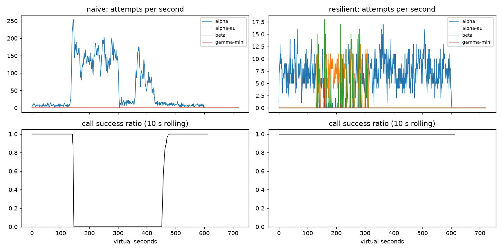

# Lab 25B — Report

**Họ tên / nhóm:** Nguyễn Tiến Tuấn — MSV 2A202602595  **Commit:** 08bf396  **Điểm tự động (`make grade`):** 84 / 88
(4 điểm còn lại là dữ liệu SLO ẩn do giảng viên chấm; trên dữ liệu public Part E PASS.)

> Mọi số liệu lấy từ `reports/gameday/*.json`, `reports/cache/*.json`, `reports/workflows.json`, `reports/slo.json`
> (seed 25 trừ khi ghi khác). Ngoài seed 25, tôi đã chạy grader với 7 seed (25, 1, 2, 3, 7, 11, 42) → 6/6 băng + C1 PASS
> trên mọi seed; và trên bản băng tự chế "khó hơn" (lệch +37 s, alpha còn 15% GPU, brown-out 45%, chậm thêm 7 s,
> traffic ×3, G1 limit 10 rps) → 6/6 PASS trên 3 seed.

## 1. Kết quả Game Day (naive vs của bạn)

| Băng | Client | availability | p95 (s) | amplification | retry_ratio | cost/turn | recovery (s) | PASS? |
|---|---|---:|---:|---:|---:|---:|---:|:---:|
| G1 | naive | 0.7194 | 7.157 | 7.738 | 6.738 | 2.163 | 4.0 | ❌ (avail, retry-after vi phạm, ampl) |
| G1 | yours | 1.0 | 4.776 | 1.062 | 0.002 | 2.101 | 0.0 | ✅ (0 vi phạm retry-after) |
| G2 | naive | 0.456 | 15.034 | 9.904 | 8.904 | 4.627 | 155.0 | ❌ (avail, ampl, recovery) |
| G2 | yours | 1.0 | 11.911 | 1.059 | 0.008 | 2.161 | 0.0 | ✅ (primary share sau restore 1.0) |
| G3 | naive | 1.0 | 4.768 | 1.164 | 0.164 | 2.328 | 0.0 | ❌ (retry_ratio) |
| G3 | yours | 1.0 | 4.738 | 1.058 | 0.034 | 2.141 | 0.0 | ✅ |
| G4 | naive | 1.0 | 13.764 | 1.004 | 0.004 | 2.008 | 0.0 | ❌ (p95) |
| G4 | yours | 1.0 | 5.562 | 1.015 | 0.002 | 2.072 | 0.0 | ✅ |
| G5 | naive | 0.3699 | 5.359 | 17.03 | 16.03 | 2.124 | – | ❌ (retry lỗi 400, avail) |
| G5 | yours | 0.8179 | 5.477 | 1.003 | 0.002 | 2.504 | – | ✅ (0 retry 400, 0 failover thừa) |
| G6 | naive | 0.517 | 4.836 | 12.344 | 11.344 | 2.009 | 0.0 | ❌ (avail) |
| G6 | yours | 1.0 | 5.961 | 1.055 | 0.018 | 2.196 | 0.0 | ✅ (0 incompatible routes) |

Naive 0/6, của tôi 6/6. Ở G5 toàn bộ 413 lượt thất bại của client mới có lý do `client_error` (request malformed — không
client nào cứu được); `unneeded_failovers = 0`, `client_error_retries = 0`.

## 2. Cấu hình client và lý do

Cấu hình mặc định trong starter đã đủ 6/6 trên 7 seed và trên băng khó hơn, nên tôi **giữ nguyên** và kiểm chứng
từng giá trị bằng thí nghiệm thay vì tinh chỉnh cho vừa seed 25 (tránh overfit băng ẩn).

| Tham số | Giá trị | Vì sao (dựa trên băng nào, số liệu nào) |
|---|---:|---|
| attempt_timeout_s | 8.0 | Bình thường p95 cả lượt ≈ 4,7 s (G1/G3), tức mỗi call < 3 s → 8 s đủ dư cho p99 bình thường. Đủ ngắn để trong deadline 30 s còn chỗ cho ≥ 2 lần fail over: G6 (alpha-eu treo) avail 1.0. Thử 30 s → G6 avail 0.9488, 107 lượt `deadline` (FAIL) — xem thí nghiệm 2. |
| max_attempts_per_provider | 2 | 1 retry cùng provider rồi fail over. Tăng lên 5 (thí nghiệm 1) chỉ làm tăng amplification G2 1.059 → 1.378 và p95 11.9 → 19.3 s, không tăng availability. |
| backoff_base_s / cap_s | 0.25 / 4.0 | Retry đầu trong [0; 0,25] s, thứ hai [0; 0,5] s — nhanh khi lỗi lẻ tẻ (G3 brown-out: avail 1.0, p95 4,74 s). Full jitter rải đều retry; cap 4 s để một retry không ăn quá 1/7 deadline. |
| retry_budget_ratio | 0.1 | Retry ≤ ~10% request đầu → G3 `retry_ratio` = 0.034 (ngưỡng 0.10). Khi breaker hỏng, budget giữ G3 ở 0.068 (PASS), tắt budget → 0.159 (FAIL) — thí nghiệm 1. |
| breaker.window_size / min_calls | 20 / 10 | ~8 call/s vào alpha → cửa sổ 20 ≈ 2,5 s lưu lượng: phản ứng nhanh ở G2/G6 nhưng ≥ 10 mẫu thì 1–2 lỗi 500 lẻ không trip. G3 (30% lỗi < 50%) không trip, retry nhẹ là đủ: avail 1.0. |
| breaker.failure_rate_threshold | 0.5 | G3 có 30% lỗi — dưới ngưỡng nên vẫn dùng alpha (rẻ nhất có tool), retry xử lý được; G2/G6 tỷ lệ lỗi ~100% → trip trong vài giây, recovery 0 s. |
| breaker.slow_call_s | 5.0 | Alpha bình thường ~1,2 s/req; G4 thêm 5 s → ~6,2 s ≥ 5 s là "chậm", 60% chậm → OPEN, traffic sang alpha-eu/beta: p95 G4 13,76 s (naive) → 5,56 s. |
| breaker.open_duration_s | 10.0 | Sau sự cố, probe sau ≤ 10 s → G2 `recovery_s` = 0, `primary_share_after_restore` = 1.0 (ngưỡng 0.8); G4/G6 cũng = 1.0. |
| breaker.half_open_max_probes | 2 | Chỉ 2 request thăm dò khi alpha vừa hồi phục, tránh thundering herd; 2 probe thành công → CLOSED. |

Sơ đồ quyết định của `on_error`:

```
lỗi ──classify──┬─ CLIENT_ERROR (400/4xx) ─ breaker.release ─────────────────────► GiveUp("client_error")
                │                           (không retry, không failover: sai ở đâu cũng sai)
                ├─ QUOTA_EXHAUSTED (429 insufficient_quota)
                │                         ─ breaker.release ─ cooldown provider 300 s ─► failover ngay
                ├─ RATE_LIMITED (429 + retry-after)
                │                         ─ breaker.release ─ cooldown = now + retry_after (chia sẻ mọi call)
                │                                                                    ─► failover ngay (delay 0)
                └─ OVERLOADED / SERVER_ERROR / TIMEOUT
                                          ─ breaker.on_failure
                                          ─ tries < max_attempts AND budget còn token AND vừa deadline?
                                                ├─ có  ─► Send cùng provider sau backoff full-jitter
                                                └─ không ─► failover
failover = idx+1 trên ladder (đã lọc tool calling) → bỏ qua provider đang cooldown / breaker OPEN
         → hết ladder: chờ cooldown rate-limit ngắn (≤ 5 s, breaker không OPEN, vừa deadline) hoặc GiveUp
```

## 3. Ba thí nghiệm

1. **Retry budget là lớp phòng thủ cuối** (seed 25, breaker hỏng `min_calls: 1e9`, `max_attempts_per_provider: 5`):

   | Cấu hình | G2 avail | G2 ampl | G2 retry_ratio | G2 recovery | G3 ampl | G3 retry_ratio |
   |---|---:|---:|---:|---:|---:|---:|
   | breaker hỏng + budget **bật** | 0.9983 | 1.378 | 0.058 | 0 s | 1.136 | 0.068 ✅ |
   | breaker hỏng + budget **tắt** | 0.9666 | **1.675** ❌ | 0.495 | 25 s | 1.162 | **0.159** ❌ |
   | breaker đúng + budget tắt | 1.0 | 1.059 | 0.008 | 0 s | 1.059 | 0.036 |
   | breaker đúng + budget bật (nộp bài) | 1.0 | 1.059 | 0.008 | 0 s | 1.058 | 0.034 |

   Khi breaker không trip, chỉ còn budget giới hạn retry: tắt nó thì retry_ratio G2 tăng 0.058 → 0.495 (×8,5), amplification
   vượt 1,6, 79 lượt hết deadline và hệ thống mất 25 s mới hồi phục — đúng là mầm mống của retry storm. Khi breaker hoạt động
   đúng, bật/tắt budget gần như không đổi số (1.059 vs 1.059) vì breaker đã cắt traffic trước khi budget cạn. Vẫn nên có cả hai:
   breaker bảo vệ *một* provider theo tỷ lệ lỗi, còn budget là giới hạn *toàn cục* không phụ thuộc vào việc cấu hình đúng —
   breaker có thể bị cấu hình sai, chưa đủ `min_calls`, hoặc lỗi rải đều dưới ngưỡng (như G3 30%), lúc đó chỉ budget chặn được.

2. **`attempt_timeout_s: 30`.** G6: availability 1.0 → **0.9488 (FAIL)**, `give_up_reasons` = `{deadline: 107,
   no_provider_available: 15}`; trong khi p95 lại *giảm* 5,96 → 5,41 s (survivorship bias: lượt bị treo 30 s ở alpha-eu
   rồi chết không được tính vào p95). G4 gần như không đổi (avail 1.0, p95 5,56 → 5,61 s) vì ở G4 alpha chỉ chậm thêm
   5 s, mọi call vẫn trả lời trong < 8 s, nên timeout không bao giờ kích hoạt — cái cứu G4 là slow-call breaker chứ không phải
   timeout. Timeout đúng phải dựa trên **cả hai**: lớn hơn p99 bình thường của một attempt (≈ 3 s), và đủ nhỏ để
   `deadline user (30 s) ≥ số lần fail over cần × timeout` — với 3 provider có tool, 8 s còn chừa thời gian cho 2–3 lần thử.

3. **Bỏ lọc tool calling khỏi `ladder()`** (G6): `incompatible_routes = 257`, availability 1.0 → 0.8922 (FAIL), 485 attempt
   rơi vào `gamma-mini`. Nói theo ngôn ngữ product: khi provider A sập, cứ khoảng 1 trên 9 khách đang xin hoàn tiền được
   chuyển sang một model "rẻ nhưng không biết dùng công cụ"; model này trả lời trơn tru nhưng không thực sự tra đơn hay
   tạo lệnh hoàn tiền — 257 khách nhận được một câu trả lời *trông như* thành công mà không có gì xảy ra. Chuyện này tệ hơn
   báo lỗi rõ ràng vì khách sẽ quay lại khiếu nại, còn dashboard của ta lại không thấy lỗi.

## 4. Workflow hoàn tiền

| Executor | completion | crashes | duplicate refunds | duplicate emails | lost refunds | overpaid | wasted LLM / crash |
|---|---:|---:|---:|---:|---:|---:|---:|
| naive | 1.0 | 81 | 128 | 81 | 0 | 1 496 700 ¢ | 1.123 |
| yours | 1.0 | 66 | **0** | **0** | **0** | **0** | **0.303** |

- **Chỉ idempotency key là chưa đủ:** payment không bị trừ hai lần, nhưng worker mới phải chạy lại *từ đầu* — gọi lại
  `classify_request` / `lookup_order` (tốn LLM, wasted LLM/crash cao như naive ≈ 1.1) — và mọi step sau đó lại phụ thuộc vào
  việc mỗi service đều hỗ trợ idempotency.
- **Chỉ checkpoint là chưa đủ:** nếu worker chết *sau* khi payment đã chạy nhưng *trước* khi ghi checkpoint (đúng kịch bản
  `crash_after_commit`), hoặc response bị mất (`ServiceTimeout`) — checkpoint chưa có, worker mới / lần retry sẽ gọi payment
  lại với một request "mới" → hoàn tiền trùng. Chỉ key ổn định `refund-agent:{session}:{step}` mới làm payment trả lại kết quả cũ.
- **Ghi checkpoint *trước* khi gọi payment:** nếu worker chết sau khi ghi checkpoint mà payment chưa chạy (hoặc payment lỗi),
  worker mới thấy checkpoint, bỏ qua step → **hoàn tiền bị mất** (khách không được trả tiền nhưng hệ thống ghi là đã xong).
  Vì vậy thứ tự đúng là: chạy step (với key ổn định) → thành công → mới ghi checkpoint.

## 5. Alerting & error budget

| Sự cố | Mong đợi | Naive alerter | Burn-rate alerter | Độ trễ phát hiện (burn-rate) |
|---|---|---|---|---:|
| checkout_bug | page | page (1 phút) | page ✅ | 27 phút |
| provider_outage | page | page (0 phút) | page ✅ | 4 phút |
| deploy_blip | none | **page (false)** | none ✅ | – |
| slow_leak | ticket | **không phát hiện** | ticket ✅ | 1337 phút (~22 h) |
| degraded_evening | page | page (214 phút) | page ✅ | 291 phút |
| night_spike | none | **page (false)** | none ✅ | – |
| small_bump | none | **page (false)** | none ✅ | – |

Naive: 7 page, 3 false page, bỏ sót slow_leak → FAIL. Burn-rate: 3 page + 1 ticket, 0 false page → PASS.

Error budget 30 ngày (`reports/slo.json`): 25 901 755 request, cho phép 129 508,8 lỗi, thực tế 55 618 lỗi →
availability 99,7853%, **đã tiêu 42,95%, còn 57,05%** → **không** đóng băng release (chỉ đóng băng khi budget ≤ 0).

`small_bump` (20 phút ở 12% lỗi): burn rate tức thời = 12% / 0,5% = 24×, nhưng trên cửa sổ 1 h chỉ còn 20/60 × 24 ≈ 8×
(< 14,4) và trên 6 h ≈ 1,3× (< 6). Tổng lượng lỗi ≈ 20 phút × 12% ≈ 2,4 "phút-sập-hoàn-toàn", tức khoảng 1,1% của budget
tháng (43 200 phút × 0,5% = 216 phút) — đã tự hết, không cần hành động gấp. Page một người chỉ vì nó là đánh đổi tệ:
gây alert fatigue mà không bảo vệ được SLO. Nó đáng được xem xét trong giờ hành chính (dashboard/ticket), không phải page.

## 6. Postmortem — Băng G2 với client naive (blameless)



**Tóm tắt:** Lúc t=120 s, deployment `alpha` mất 75% GPU trong 3 phút. Client v1 có 3 tầng retry chồng nhau (tối đa
36 attempt/call), delay cố định, không breaker/fallback, nên đã nhân tải lên alpha ~20 lần và giữ hàng đợi đầy request
"ma". Kết quả: tỷ lệ call thành công về 0 từ t≈145 s đến t≈450 s — sự cố 3 phút ở provider thành **~5 phút sập hoàn toàn**,
kéo dài 150 s sau khi alpha đã hồi phục.

**Ảnh hưởng:** 2 362 lượt user trong băng, chỉ 1 077 thành công → **1 285 lượt thất bại** (availability 45,6%); 655 call
`retries_exhausted`, 585 call hết `deadline`. Thời gian sập hoàn toàn ≈ 305 s (t≈145 → t≈450). Chi phí/lượt thành công
4,627 (gấp ~2,2 lần bình thường) vì phần lớn công sức của server bị phí cho request client đã bỏ. Budget tháng (giả sử
4 lượt/s × 30 ngày = 10 368 000 lượt, SLO 99,5% → 51 840 lượt được phép lỗi): sự cố này tiêu **≈ 2,5% budget tháng**
trong 5 phút — tương đương burn rate ~ 300× trong cửa sổ đó.

**Timeline** (giây ảo — từ `reports/gameday/naive_G2_overload_storm_timeseries.csv`, trung bình theo khoảng):

| t | Sự kiện | Bằng chứng (số) |
|---:|---|---|
| 60–120 | Bình thường | 7,6 attempt/s vào alpha, success 1,00 |
| 120 | alpha mất 75% năng lực (18 → ~4,5 slot) | 120–130 s: hàng đợi dài lên, call hoàn tất giảm 7,6 → 3,2/s nhưng vẫn thành công |
| 130–150 | Timeout & 529 kích hoạt 3 tầng retry | attempt vào alpha nhảy lên **133/s** (×17), success rớt 0,29; đỉnh ~250 attempt/s ở t≈143 |
| 150–300 | Retry storm tự duy trì | 141–152 attempt/s, success **0,00**; 26 298 lỗi `rate_limit_exceeded` (retry vào thẳng rate limit, 28 381 vi phạm retry-after), 3 194 `overloaded_error`, 2 737 `client_timeout` |
| 300 | alpha hồi phục hoàn toàn | — |
| 300–360 | Provider đã khoẻ nhưng hệ thống vẫn sập | attempt giảm còn 16–27/s nhưng success vẫn **0,00**: hàng đợi còn đầy request mà client đã bỏ |
| 360–420 | Đợt retry thứ hai | lượt user mới chạm hàng đợi dài → timeout → retry lại: 95,5 attempt/s, success 0,00 |
| 420–450 | Hàng đợi dần xả | 21,5 attempt/s, success 0,00 |
| 450–480 | Bắt đầu hồi phục | success 0,90, 11 call/s (xả backlog) |
| 480+ | Hồi phục | 8,8 attempt/s, success 1,00 — `recovery_s` = 155 s (ngưỡng 30 s) |

**Trigger vs root cause:**
- *Trigger:* alpha mất 75% GPU trong 3 phút (sự cố hạ tầng của provider — nằm ngoài tầm kiểm soát của ta, và sẽ còn xảy ra).
- *Root cause:* lớp gọi LLM của ta khuếch đại thay vì hấp thụ sự cố: retry ở 3 tầng (app × gateway × SDK = tối đa 36
  attempt/call, amplification thực tế 9,9), delay cố định không jitter, không tôn trọng `retry-after`, không retry budget,
  không circuit breaker và không fallback sang `alpha-eu`/`beta` vốn đang khoẻ.
- *Vì sao không tự hồi phục sau t=300 (metastable failure):* vòng lặp tự duy trì là **request chậm → client timeout →
  retry thêm request → hàng đợi dài hơn → càng nhiều timeout**. Khi client timeout, server *vẫn* xử lý request cũ, nên
  năng lực đã hồi phục của alpha bị tiêu vào việc mà không ai còn chờ. Chừng nào lượng retry còn lớn hơn năng lực
  (95 attempt/s ở t=360–420 so với ~15 req/s alpha xử lý được), hàng đợi không bao giờ rút xuống dưới ngưỡng 10 s → mọi
  request mới đều nhận 529/timeout. Chỉ khi lượt user cũ hết deadline và bỏ đi (t≈450) tải mới tụt dưới năng lực.

**Điều gì giúp / điều gì làm tệ hơn:**
- Giúp: user có deadline 30 s nên cuối cùng tải retry tự tắt; rate limit của alpha cắt bớt một phần tải (nhưng client lại
  retry thẳng vào 429).
- Làm tệ hơn: retry chồng 3 tầng; delay cố định khiến các retry đồng bộ thành từng đợt (đỉnh 250/s ở t≈143, đợt 2 ở t≈370);
  bỏ qua `retry-after`; không có fallback dù `alpha-eu` và `beta` còn ~46 slot rảnh; không có tín hiệu cảnh báo theo
  amplification, nên không ai thấy retry storm cho tới khi availability đã về 0.

**Action items:**

| # | Hành động | Loại | Owner | Cách kiểm chứng |
|---|---|---|---|---|
| 1 | Thay `NaiveClient` bằng `ResilientClient`: retry đúng 1 tầng (tắt retry ở gateway và SDK), full jitter, tôn trọng `retry-after`, retry budget 10% | prevent | Team platform LLM | CI chạy `make gameday`: G2 amplification ≤ 1,2 (hiện 1,059), retry_after_violations = 0 |
| 2 | Sliding-window breaker cho từng deployment + fallback ladder alpha → alpha-eu → beta (lọc tool calling) | mitigate | Team platform LLM | CI: G2 recovery_s ≤ 30 (hiện 0), availability ≥ 95% (hiện 100%), primary_share_after_restore ≥ 0,8 |
| 3 | Dashboard + alert cho `amplification` và `retry_ratio` theo provider (page khi amplification > 2 trong 5 phút liên tục) | detect | On-call SRE | Game day hàng quý: replay băng G2 với client naive, alert phải bắn trong ≤ 2 phút từ t=120 |
| 4 | Burn-rate alert đa cửa sổ (14,4×/6×/1×) thay cho alert ngưỡng 5 phút | detect | On-call SRE | `make slo`: page đúng mọi sự cố lớn, 0 false page |
| 5 | Game day định kỳ với 6 băng sự cố, chạy trong CI cho mọi thay đổi ở lớp gọi LLM | prevent | Tech lead ShopAgent | Pipeline fail nếu bất kỳ băng nào FAIL trên 3 seed |

*Blameless:* Thiết kế 3 tầng retry hình thành vì mỗi tầng (app, gateway, SDK) được thêm hợp lý *một cách độc lập* để chống
lỗi lẻ tẻ; không có quy trình nào xem xét tổng số attempt khi các tầng chồng lên nhau. Bài học là về hệ thống và quy trình
review, không về cá nhân nào.

## 7. Một điểm yếu còn lại

**p95 ở G2 = 11,9 s** (naive 15,0 s) dù availability 100%. Trong lúc breaker của alpha còn CLOSED (cần ≥ 10 kết quả, ≥ 50% lỗi),
nhiều call đầu tiên phải chờ trong hàng đợi đầy của alpha tới khi nhận 529 sau ~10 s hoặc timeout 8 s rồi mới fail over;
và mỗi lần breaker sang HALF-OPEN, probe gặp hàng đợi chậm lại tốn thêm vài giây. Băng không chấm p95 ở G2, nhưng user vẫn
cảm nhận. Cách sửa: (1) **hedging / adaptive timeout** — timeout attempt dựa trên p99 gần nhất của provider (vd. 3× p50 động)
thay vì cố định 8 s; (2) dùng slow-call breaker với ngưỡng thấp hơn cho call đang chờ hàng đợi (vd. 3 s); (3) theo dõi độ trễ
hàng đợi qua header nếu provider có, để fail over trước khi bị 529. Điểm yếu thứ hai: khi beta gánh tải (G6) chi phí/lượt
tăng 2,07 → 2,20 (+6%) — chấp nhận được, nhưng một sự cố dài cần alert theo chi phí.

## 8. Cache (Part G)

Số từ `reports/cache/*.json` (`make cache`, seed 25).

| Client | availability | faq_availability | cache_hit_ratio | stale_served | wrong_answers | outdated_answers | cost/turn | PASS? |
|---|---:|---:|---:|---:|---:|---:|---:|:---:|
| resilient (không cache) | 0.8373 | 0.8424 | 0.0 | 0 | 0 | 0 | 1.386 | ❌ (faq_avail, hit ratio) |
| cached (của bạn) | 0.9124 | 0.9645 | 0.652 | 157 | 0 | 3 | 0.915 | ✅ |

Cache giảm chi phí/lượt 34% (1,386 → 0,915) và nâng faq_availability từ 84,2% lên 96,5% nhờ stale-if-error trong 2 phút mọi
provider sập. PASS trên 7 seed (25, 1, 2, 3, 7, 11, 42).

| Tham số `cache:` | Giá trị | Vì sao (số liệu nào) |
|---|---:|---|
| similarity_threshold | 0.92 | Paraphrase cùng intent có cosine ~0,94–0,98, hai intent "gần mà khác" ~0,86. 0,80 → 157 `other_question`; 0,85 vẫn còn 1 câu nhầm ở seed 2; 0,88–0,95 cho kết quả giống hệt nhau (0 sai, hit 0,652) → chọn 0,92 ở giữa khoảng trống, biên 0,02–0,06 về hai phía. 0,97 vẫn đúng nhưng hit ratio tụt 0,581, cost tăng 0,964. |
| ttl_s | 60 | Giới hạn thay đổi không báo trước (bảng phí ship t=480): 30 s → outdated 2, hit 0,592; 60 s → outdated 3 (≤ 5 trên 3 seed), hit 0,652; 120 s → 24–27 (FAIL); 300 s → 95 (FAIL). |
| max_stale_s | 300 | Phải dài hơn sự cố: mọi provider sập 120 s (t=240–360). 0 → faq_availability 0,8733 (FAIL); 120 → 0,950–0,960; 300 = 600 → 0,9645. Chọn 300 để vẫn phủ được một sự cố dài hơn (đã thử sập 180 s: stale vẫn phục vụ đủ, phần thiếu chỉ là câu hỏi cá nhân). |
| max_entries | 500 | Catalog FAQ nhỏ; không có eviction ảnh hưởng tới kết quả. |

Thí nghiệm:

1. **Ngưỡng** (ttl 60, stale 300): 0,80 → hit 0,666, `wrong_answers = 157` toàn bộ `other_question`, cost 0,965, FAIL;
   0,92 → hit 0,652, 0 sai, cost 0,915; 0,97 → hit 0,581, 0 sai, cost 0,964. Ở 0,80 cache trả nhầm các cặp intent có
   centroid cách nhau cosine ~0,86, ví dụ "chính sách hoàn tiền" vs "bao lâu thì nhận được tiền hoàn", "phí ship nội thành"
   vs "phí ship đi tỉnh" — câu hỏi nghe giống nhau nhưng câu trả lời khác nhau. Lưu ý cost ở 0,80 *cao hơn* 0,92 vì câu trả
   lời sai bị tính là lượt hỏng.
2. **TTL** (ngưỡng 0,92): 30 s → outdated 2 / hit 0,592 / cost 0,955; 60 s → 3 / 0,652 / 0,915; 300 s → **95** / 0,731 /
   0,863 (FAIL). Webhook chỉ giúp với thay đổi *được báo* (chính sách hoàn tiền t=150: 0 `ignored_invalidation`). Bảng phí
   ship đổi ở t=480 **không** có webhook, nên cache không có cách nào biết entry đã cũ — thứ duy nhất giới hạn số câu trả lời
   lỗi thời là tuổi tối đa của entry, tức TTL. Đó là đánh đổi trực tiếp giữa hit ratio/chi phí và độ tươi.
3. **Stale-if-error** (`max_stale_s: 0`): faq_availability 0,9645 → **0,8733** (FAIL), stale_served 157 → 0, cost 0,915 →
   0,975. Không có stale, trong 120 s mọi provider sập mọi câu hỏi FAQ đều thất bại dù cache vừa có câu trả lời 1–2 phút trước.

Trả lời:

- **Vì sao không cache câu hỏi cá nhân, kể cả theo từng user?** (1) Rủi ro rò rỉ: semantic cache khớp theo *nghĩa*, nên "Đơn
  #48213 của tôi ở đâu?" của user A khớp gần như tuyệt đối với câu tương tự của user B → lộ dữ liệu người khác
  (`other_user`). Scope theo user giảm rủi ro nhưng chỉ cần một bug ở khoá scope là thành sự cố bảo mật. (2) Dữ liệu cá nhân
  thay đổi theo phút (trạng thái đơn, tiền hoàn, điểm) mà **không có webhook/TTL nào khớp** — câu trả lời cũ là sai.
  (3) Hit ratio gần 0: mỗi user hỏi về đơn của mình vài lần, nên cache không tiết kiệm được gì mà chỉ thêm rủi ro.
- **Dashboard xanh nhờ cache khi provider sập — alert dựa trên gì?** Alert trên tín hiệu của *provider* chứ không phải của user:
  tỷ lệ `stale_served` / lượt FAQ (bình thường = 0; >5% trong 5 phút là page), tỷ lệ lỗi/`GiveUp` của lớp gọi provider (bỏ qua
  cache), trạng thái breaker OPEN của mọi deployment, và availability của lượt **không phải FAQ** (cần tool call — cache không
  cứu được, ở C1 tổng availability chỉ 0,9124 so với faq 0,9645). Đồng thời đo thời gian stale tối đa còn lại: nếu sự cố dài
  hơn `max_stale_s`, faq_availability sẽ sụp đột ngột.
